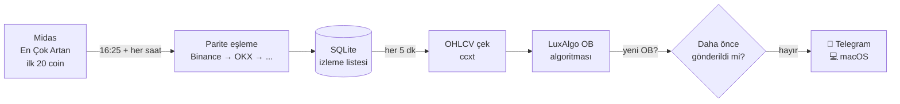

# 📈 Midas OB Alert Bot

**Midas "En Çok Artan" kripto listesini takip eden ve listedeki coinlerde yeni bir Order Block (OB) oluştuğu anda telefona ve bilgisayara bildirim gönderen bot.**


> ⚠️ **Bu bir bildirim aracıdır, yatırım tavsiyesi değildir.** Bot hiçbir borsada emir açmaz, hiçbir hesaba erişmez, sadece herkese açık fiyat verisini okur ve bildirim gönderir.

---

## İçindekiler

- [Ne işe yarar?](#ne-işe-yarar)
- [Özellikler](#özellikler)
- [Nasıl çalışır?](#nasıl-çalışır)
- [Bildirim örnekleri](#bildirim-örnekleri)
- [Kurulum](#kurulum)
- [Çalıştırma ve durdurma](#çalıştırma-ve-durdurma)
- [Telegram komutları](#telegram-komutları)
- [Ayarlar](#ayarlar)
- [Order Block mantığı](#order-block-mantığı)
- [Proje yapısı](#proje-yapısı)
- [Geliştirme ve test](#geliştirme-ve-test)
- [Sorun giderme](#sorun-giderme)
- [Lisans ve teşekkür](#lisans-ve-teşekkür)

---

## Ne işe yarar?

Gün içinde en çok yükselen coinler genelde güçlü hareketin içindedir. Bu bot:

1. [Midas'ın "En Çok Artan" kripto listesini](https://www.getmidas.com/canli-kripto/en-cok-artan) düzenli olarak alır,
2. her coinin borsadaki **USDT paritesini** bulur,
3. bu coinlerin **5 dakikalık grafiğini** sürekli tarar,
4. TradingView'de kullanılan **LuxAlgo ICT Concepts** indikatörünün Order Block mantığıyla **yeni bir bullish OB** oluştuğu anda
5. **Telegram** (telefon + masaüstü) ve **macOS** bildirimi gönderir. Bildirimde OB bölgesi, fiyat ve tek tıkla açılan **TradingView grafik linki** bulunur.

Böylece 20 coinin grafiğini tek tek izlemek yerine, sadece sinyal geldiğinde grafiğe bakmanız yeterli olur.

## Özellikler

- 🔄 **Canlı liste:** Midas listesi 16:25'te alınır ve tarama boyunca **her saat** yenilenir. Listeye yeni giren coin otomatik olarak taramaya eklenir.
- ⏱️ **Mum kapanışına hizalı tarama:** Her 5 dakikalık mum kapandıktan ~10 saniye sonra tüm coinler taranır.
- 🧠 **LuxAlgo OB portu:** Pine Script'teki OB algoritması Python'a satır satır çevrildi. Sadece kapanmış mumlar kullanılır, sinyal sonradan kaybolmaz (repaint yok).
- 🏦 **6 borsa desteği:** Binance → OKX → Bybit → Gate → KuCoin → MEXC sırasıyla parite aranır. API anahtarı gerekmez.
- 🔔 **Çoklu bildirim kanalı:** Telegram, macOS ve isteğe bağlı [ntfy](https://ntfy.sh).
- 🚫 **Tekrar yok:** Aynı sinyal asla iki kez gönderilmez (SQLite). Listeye geç giren coinlerin eski OB'leri bildirilmez.
- 🤖 **Telegram'dan kontrol:** `/durum`, `/bugun`, `/liste`, `/durdur`, `/baslat` gibi komutlar.
- 🛡️ **Dayanıklı:** Borsa hatasında yeniden dener, gönderilemeyen bildirimi kuyruğa alır, art arda hata olursa tek bir uyarı yollar, çökerse kendini yeniden başlatır.
- 💸 **Ücretsiz:** Hiçbir ücretli servis kullanmaz.

## Nasıl çalışır?



### Günlük akış (İstanbul saati)

| Saat | Ne olur |
|---|---|
| **16:25** | Midas listesinin ilk 20 coini alınır, borsa paritelerine eşlenir ve tam liste gönderilir. |
| **16:30** | Tarama başlar. Liste alınamadıysa hatırlatma gelir. |
| **Her 5 dakikada** (16:35:10, 16:40:10 …) | Güncel listedeki tüm coinler taranır. Yeni OB varsa bildirim gönderilir. |
| **17:25, 18:25 … 23:25** | Liste yeniden alınır. Değiştiyse eklenen/çıkan coinler bildirilir, değişmediyse mesaj gelmez. |
| **23:59** | Tarama durur. Bot açık kalır, ertesi gün 16:25'te yeniden başlar. |

Hafta sonu dahil her gün çalışır. Bot 16:25'ten sonra açılırsa listeyi hemen alır.

## Bildirim örnekleri

**Yeni OB sinyali:**
```
🟢 BULLISH OB — XYZ/USDT (5m)
Bölge: 0.4123 – 0.4189
Fiyat: 0.4231
Mum: 17:45 (İST)
Borsa: Binance
📈 https://www.tradingview.com/chart/?symbol=BINANCE:XYZUSDT&interval=5
```

| Alan | Anlamı |
|---|---|
| Bölge | Order Block'un alt ve üst fiyatı |
| Fiyat | Sinyali veren mumun kapanış fiyatı |
| Mum | Sinyalin oluştuğu mumun kapanış saati |
| 📈 | Grafiği TradingView'de 5 dakikalık olarak açar |

**Saatlik liste değişikliği:**
```
🔄 Midas listesi güncellendi
➕ Eklenen: ABC (BINANCE:ABCUSDT)
➖ Çıkan: DEF
```

## Kurulum

Gereken: **Python 3.11+** ve bir **Telegram** hesabı.

### 1. Projeyi indirin ve kurun

```bash
git clone https://github.com/miracxdev/midas-ob-alert-bot.git ~/development/midas-ob-alert-bot
cd ~/development/midas-ob-alert-bot

RT="$HOME/Library/Application Support/obbot"
python3 -m venv "$RT/venv"
ln -sfn "$RT/venv" .venv
.venv/bin/pip install -e '.[dev]'
cp .env.example .env
```

> 💡 **Proje klasörünü Masaüstü veya Belgeler'e koymayın.** Bu klasörler iCloud ile senkronize olabilir. iCloud dosyaları buluta taşıdığında arka plandaki bot onları okuyamaz ve çöker. Sanal ortam, veritabanı ve loglar bu yüzden `~/Library/Application Support/obbot/` altında tutulur (`OBBOT_HOME` ile değiştirilebilir).

### 2. Telegram botunu bağlayın

1. Telegram'da **@BotFather** → `/newbot` → isim verin → verilen token'ı `.env` dosyasına yazın: `TELEGRAM_BOT_TOKEN=...`
2. Yeni botunuza herhangi bir mesaj atın (ör. `merhaba`).
3. Tarayıcıda `https://api.telegram.org/bot<TOKEN>/getUpdates` adresini açın. `"chat":{"id":123456789` kısmındaki sayıyı `.env` dosyasına yazın: `TELEGRAM_CHAT_ID=123456789`
4. Deneyin: `.venv/bin/python scripts/test_notify.py` telefona ve Mac'e örnek bir bildirim gönderir.

> 🔒 `.env` dosyası `.gitignore` içindedir ve GitHub'a gönderilmez. Token'ınızı asla `.env.example` dosyasına yazmayın. Bot yalnızca `.env`'deki `TELEGRAM_CHAT_ID`'den gelen komutlara cevap verir.

### 3. macOS bildirimleri

Varsayılan olarak `osascript` kullanılır. Bildirim gelmiyorsa: **Sistem Ayarları → Bildirimler → Script Editor** bölümünden bildirimleri açın. Bildirime tıklayınca grafiğin açılmasını isterseniz `brew install terminal-notifier` kurun, bot onu otomatik kullanır.

## Çalıştırma ve durdurma

### Elle çalıştırma

```bash
.venv/bin/python -m obbot.main            # botu başlat (Ctrl+C ile durdur)
.venv/bin/python -m obbot.main --check    # sadece ayarları kontrol et
```

### Arka planda sürekli çalıştırma (önerilen)

Mac açıldığında otomatik başlar, çökerse kendini yeniden başlatır:

```bash
./scripts/install_launchd.sh              # kur ve başlat
./scripts/install_launchd.sh uninstall    # kaldır
```

| İşlem | Komut |
|---|---|
| Taramayı duraklat / devam ettir | Telegram'dan `/durdur` / `/baslat` |
| Botu tamamen kapat | `launchctl bootout gui/$(id -u)/com.obbot.midas` |
| Botu tekrar aç | `launchctl bootstrap gui/$(id -u) ~/Library/LaunchAgents/com.obbot.midas.plist` |
| Çalışıyor mu? | `launchctl print gui/$(id -u)/com.obbot.midas \| grep "state ="` |

Loglar: `~/Library/Application Support/obbot/logs/`

> 💤 **Mac uyurken tarama yapılmaz.** Tarama saatlerinde Mac'i uyanık tutmak için Sistem Ayarları → Pil → Seçenekler → "Güç adaptörüne bağlıyken otomatik uyumayı engelle" ayarını açın. 7/24 çalıştırmak için küçük bir VPS veya Raspberry Pi kullanabilirsiniz: [deploy/obbot.service](deploy/obbot.service).

## Telegram komutları

| Komut | İşlev |
|---|---|
| `/bugun` | Bugünün izleme listesi ve eşlenen pariteler |
| `/durum` | Son tarama zamanı, hata sayısı, tarama penceresi |
| `/yenile` | Listeyi Midas'tan hemen yeniden çek |
| `/liste XYZ ABC ...` | Bugünün listesini elle ayarla (saatlik yenileme bu listeye dokunmaz) |
| `/test` | Deneme bildirimi |
| `/durdur` / `/baslat` | Taramayı duraklat / devam ettir |

## Ayarlar

Tüm ayarlar [config.yaml](config.yaml) dosyasındadır. Değişiklikten sonra botu yeniden başlatın.

| Ayar | Değer | Açıklama |
|---|---|---|
| `watchlist.refresh_at` | `16:25` | Listenin ilk alındığı saat |
| `watchlist.top_n` | `20` | Listenin ilk kaç coini izlenir |
| `watchlist.hourly_refresh` | `true` | Tarama boyunca listeyi her saat yenile |
| `watchlist.max_change_pct` | `null` | Ör. `500` → %500'den fazla artan (hatalı veri olabilecek) coinleri atla |
| `scan_window` | `16:30–23:59` | Tarama penceresi. Gece yarısını aşabilir: `{start: "16:30", end: "04:00"}` |
| `days` | her gün | Ör. `[mon, tue, wed, thu, fri]` |
| `timeframes` | `["5m"]` | Ör. `["5m", "15m"]`; her biri ayrı sinyal üretir |
| `max_signal_age_bars` | `3` | Bundan eski mumlarda oluşan OB'ler bildirilmez |
| `ob.engine` | `custom` | `custom` = LuxAlgo portu, `default` = basit swing/BOS mantığı |
| `ob.direction` | `bullish` | `bullish`, `bearish` veya `both` |
| `ob.events` | `[ob_formed]` | `ob_retest` eklenirse fiyat OB bölgesine geri döndüğünde de bildirir |
| `ob.params.swing_len` | `10` | LuxAlgo'daki **Swing Lookback** |
| `ob.params.use_body` | `true` | LuxAlgo'daki **Use Candle Body** |
| `notifiers` | `[telegram, macos]` | `ntfy` de eklenebilir (`.env` → `NTFY_TOPIC`) |

Midas'taki bir sembol borsada farklı adla geçiyorsa [data/symbol_aliases.yaml](data/symbol_aliases.yaml) dosyasına ekleyin (ör. `"1000PEPE": "PEPE"`).

## Order Block mantığı

Bot, TradingView'deki **LuxAlgo ICT Concepts** indikatörünün Order Block bölümünü kullanır ([indicator/ob.pine](indicator/ob.pine) → [src/obbot/ob/custom.py](src/obbot/ob/custom.py)):

1. **Swing tespiti:** Bir barın yükseği, ardından gelen `swing_len` barın hepsinden yüksekse o bar **swing high** olur (swing low için simetrik).
2. **Bullish OB:** Kapanış kırılmamış son swing high'ın **üstüne** çıktığında (yapı kırılımı), swing barı ile kırılım barı arasındaki **en düşük gövdeye** sahip mum OB olur.
3. **Bearish OB:** Simetriği (swing low'un altında kapanış).
4. **Breaker:** Mum gövdesi OB bölgesinin ötesine geçerse OB geçersiz sayılır.
5. **Sinyal zamanı:** Kırılım mumunun **kapanışı**. Sadece kapanmış mumlar kullanılır.

> 📌 TradingView'deki indikatör OB'yi mum henüz kapanmadan çizebilir; mum geri düşerse OB kaybolur. Bot sahte sinyal göndermemek için mumun kapanmasını bekler. Bu yüzden bildirim, TradingView'de görünmesinden en fazla bir mum (5 dk) sonra gelebilir.

### TradingView ile karşılaştırma

```bash
.venv/bin/python scripts/backtest_ob.py BINANCE:BTCUSDT 5m           # son 300 mumdaki OB'ler
.venv/bin/python scripts/run_once.py --midas --hours 6               # Midas listesiyle tek tarama
```

Çıktıdaki saat ve bölgeleri TradingView'de aynı zaman dilimi ve aynı LuxAlgo ayarlarıyla karşılaştırın.

## Proje yapısı

```
midas-ob-alert-bot/
├── config.yaml              # tüm ayarlar
├── .env.example             # Telegram token / chat id şablonu
├── indicator/ob.pine        # LuxAlgo ICT Concepts (Pine Script kaynağı)
├── data/symbol_aliases.yaml # Midas sembolü → borsa sembolü eşlemeleri
├── deploy/                  # macOS launchd ve Linux systemd dosyaları
├── scripts/                 # kurulum, test ve hata ayıklama scriptleri
├── src/obbot/
│   ├── main.py              # giriş noktası: zamanlayıcı + Telegram komutları
│   ├── scheduler.py         # 16:25 liste, saatlik yenileme, 5 dk tarama
│   ├── scanner.py           # tarama, eski sinyal filtresi, tekrar kontrolü
│   ├── watchlist.py         # liste alma, değişiklik tespiti
│   ├── sources/             # Midas web kaynağı, dosya kaynağı
│   ├── markets/             # parite eşleme (resolver) ve OHLCV (ccxt)
│   ├── ob/                  # custom.py (LuxAlgo portu), default.py
│   ├── notify/              # Telegram, macOS, ntfy
│   ├── bot/commands.py      # /durum, /bugun, /liste ...
│   └── db.py                # SQLite: liste, gönderilen sinyaller, tarama kayıtları
└── tests/                   # pytest testleri
```

## Geliştirme ve test

```bash
.venv/bin/pytest            # tüm testler
.venv/bin/ruff check src    # lint
.venv/bin/python scripts/test_notify.py   # örnek bildirim gönder
```

Testler OB algoritmasını elle kurulmuş mum senaryolarıyla, zamanlayıcıyı ise saati taklit eden (`freezegun`) entegrasyon testleriyle doğrular.

## Sorun giderme

| Sorun | Çözüm |
|---|---|
| Hiç bildirim gelmiyor | `/durum` ile botun çalıştığını kontrol edin. Sinyal ancak yeni OB oluştuğunda gelir; bazı saatlerde hiç çıkmayabilir. |
| Telegram cevap vermiyor | `.env` içinde `TELEGRAM_CHAT_ID` dolu mu? Botu yeniden başlatın. |
| Mac bildirimi gelmiyor | Sistem Ayarları → Bildirimler → Script Editor açık mı? Odak modu kapalı mı? |
| Liste gelmedi | Midas sayfasının yapısı değişmiş olabilir. Loglara bakın; geçici çözüm `/liste XYZ ABC`. |
| "parite bulunamadı" | Coin 6 borsanın hiçbirinde USDT/USD paritesine sahip değil ya da adı farklı → `symbol_aliases.yaml`. |
| Bot sürekli çöküyor | Proje iCloud ile senkronize bir klasörde olabilir. `~/development/` gibi bir yere taşıyıp `install_launchd.sh`'ı yeniden çalıştırın. |
| Art arda hata uyarısı | Genelde internet ya da borsa kaynaklıdır, kendiliğinden düzelir. |

## Lisans ve teşekkür

- **Order Block algoritması:** [indicator/ob.pine](indicator/ob.pine) dosyası ve onun Python portu [src/obbot/ob/custom.py](src/obbot/ob/custom.py), **© LuxAlgo** tarafından [CC BY-NC-SA 4.0](https://creativecommons.org/licenses/by-nc-sa/4.0/) lisansıyla yayımlanan *ICT Concepts [LuxAlgo]* indikatörüne dayanır. Bu dosyalar aynı lisansla, **ticari olmayan** kullanım için paylaşılmıştır.
- **Liste kaynağı:** Midas'ın herkese açık [En Çok Artan](https://www.getmidas.com/canli-kripto/en-cok-artan) sayfası. Bu proje Midas ile bağlantılı değildir.
- **Fiyat verisi:** [ccxt](https://github.com/ccxt/ccxt) üzerinden borsaların herkese açık API'leri.

> Bu yazılım yalnızca bilgilendirme amaçlıdır. Kripto para yatırımları yüksek risk içerir; verilen sinyaller alım-satım tavsiyesi değildir.
